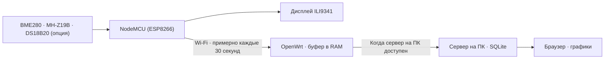
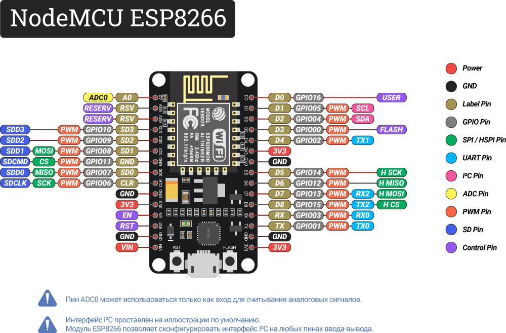
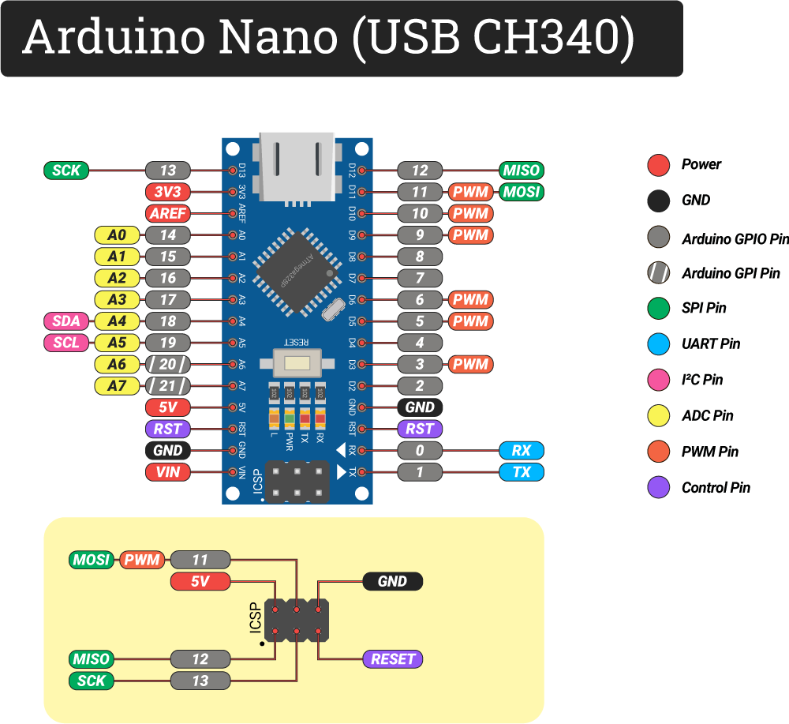

# meteo

##  NodeMCU
### Как работает метеостанция

NodeMCU на ESP8266 считывает температуру, влажность и давление с BME280 и концентрацию CO₂ с MH‑Z19B. Показания выводятся на дисплей ILI9341. Дополнительный DS18B20 можно включить в [конфигурации прошивки](./NodeMCU/meteo/src/config.h). В браузере его температура отображается отдельной линией.



Пока ПК выключен, роутер хранит до **10 дней** измерений в оперативной памяти (около **0,88 МиБ**). Когда сервер снова доступен, накопленные данные записываются в SQLite с исходным временем, без дублей. Перезагрузка роутера очищает неотправленную очередь. Для сбора при выключенном ПК NodeMCU требуется независимое питание.

[Панель метеостанции](http://localhost:8780/) показывает историю от **1 часа до 1 года**. По умолчанию открывается последний час.

[Настройка и запуск телеметрии](./NodeMCU/meteo-telemetry/README.md).

### Подключение и внешний вид


#### Вывод на дисплей производится в таком виде:


#### PinOut Отладочной платы




## Arduino Nano

Версия для классической **Arduino Nano с ATmega328P (5 В)** показывает на ILI9341 температуру, влажность, давление и CO₂. Температуру берёт с DS18B20. Если данных от него нет, использует температуру BME280. Диагностика доступна через USB-UART на **9600 бод**.

Пины и переключатели модулей заданы в [конфигурации Nano](./Arduino_nano/meteo/src/config.h). Реализации датчиков и дисплея находятся в [общем каталоге](./shared/Meteo/src). Nano опрашивает модули из своего [main.cpp](./Arduino_nano/meteo/src/main.cpp). Для цифр на TFT используется компактный шрифт 5×7, а при изменении показаний перерисовывается только соответствующее поле. Графики и отправка данных по Wi-Fi доступны в версии NodeMCU.

### Подключение

Все модули и источники питания должны иметь общую землю.

| Модуль | Сигналы Arduino Nano | Питание и согласование |
| --- | --- | --- |
| MH‑Z19B | TX датчика → D2 (RX Nano), D3 (TX Nano) → RX датчика | Стабильные 5 В на VIN датчика, до 150 мА в пике. Для линии D3 → RX используйте согласование 5 → 3,3 В. Пины D0/D1 свободны для USB-UART. |
| DS18B20 | DQ → D4 | 5 В. Резистор 4,7 кОм между DQ и +5 В. |
| BME280 | SDA → A4, SCL → A5 | Для 3,3-вольтового модуля используйте питание 3,3 В и двунаправленное согласование I²C. В конфиге задан адрес 0x76. |
| ILI9341 (SPI) | SCK → D13, MOSI/SDI → D11, CS → D10, DC → D9, RST → D8 | VCC и подсветка LED/BL — по документации модуля. Если плата дисплея не поддерживает логику 5 В, согласуйте все пять линий Nano → TFT с 3,3 В. SDO/MISO для вывода изображения не нужен. |

Если у BME280 выведены CSB и SDO, подключите CSB к 3,3 В для режима I²C. SDO на GND задаёт адрес 0x76, на 3,3 В — 0x77. При адресе 0x77 измените `METEO_BME280_I2C_ADDRESS` в конфиге.

Для MH‑Z19B Nano использует программный UART. Настройка `METEO_MHZ19B_ABC` задаёт автокалибровку. В текущем конфиге стоит 1 (включена), 0 выключает её, а -1 оставляет настройку датчика. ABC рассчитана на условия, в которых концентрация регулярно снижается примерно до 400 ppm.



### Сборка

Откройте [проект Nano](./Arduino_nano/meteo/platformio.ini) в PlatformIO или запустите из корня репозитория:

```powershell
pio run -d Arduino_nano/meteo
```

Параметр `board` в `platformio.ini` сейчас установлен в `nanoatmega328` (классическая Nano со старым загрузчиком). Для платы с новым загрузчиком укажите `nanoatmega328new`.
