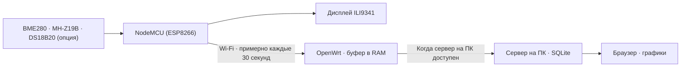
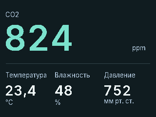

# meteo

##  NodeMCU
### Как работает метеостанция

NodeMCU на ESP8266 считывает температуру, влажность и давление с BME280 и концентрацию CO₂ с MH‑Z19B. Показания выводятся на дисплей ILI9341. Дополнительный DS18B20 можно включить в [конфигурации прошивки](./NodeMCU/meteo/src/config.h). В браузере его температура отображается отдельной линией.

Пока ПК выключен, роутер хранит до **10 дней** измерений в оперативной памяти (около **0,88 МиБ**). Когда сервер снова доступен, накопленные данные записываются в SQLite с исходным временем, без дублей. Перезагрузка роутера очищает неотправленную очередь. Для сбора при выключенном ПК NodeMCU требуется независимое питание.

[Панель метеостанции](http://localhost:8780/) показывает историю от **1 часа до 1 года**. По умолчанию открывается последний час.

[Настройка и запуск телеметрии](./NodeMCU/meteo-telemetry/README.md).

### Подключение и внешний вид

#### Вывод на дисплей производится в таком виде:

#### PinOut Отладочной платы

